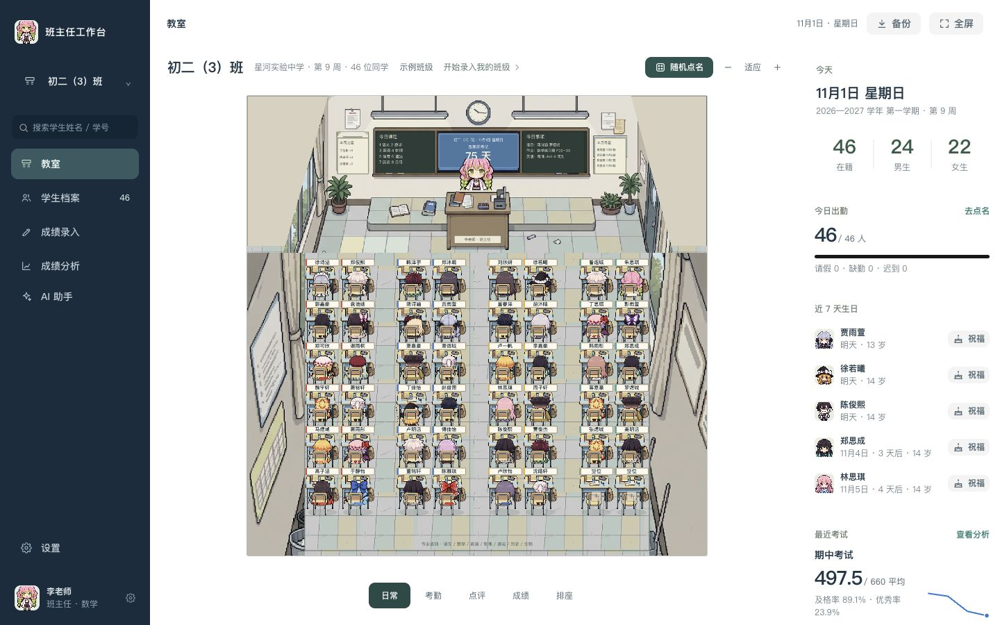
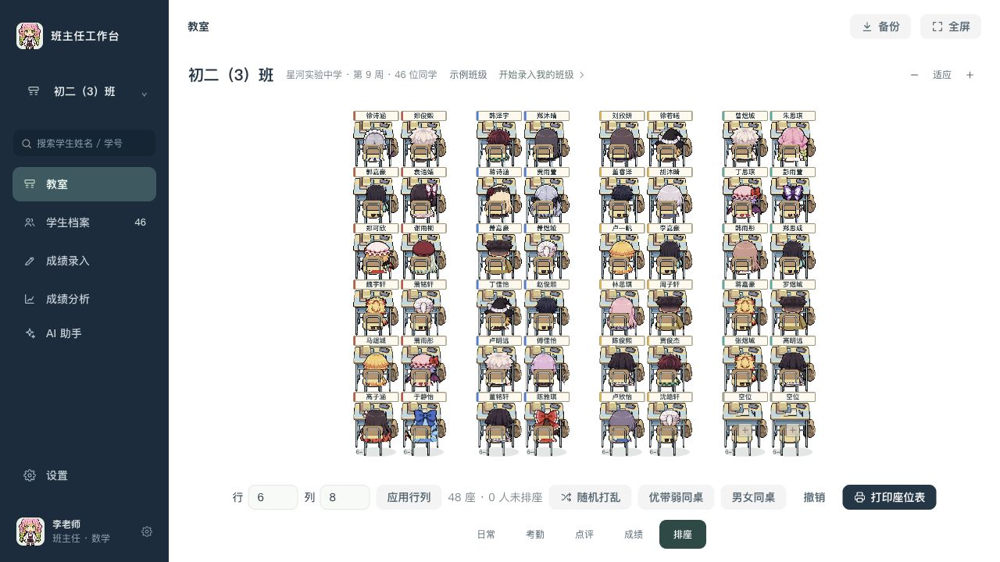

# cyz的教师工作台

把班级日常、学生档案、成绩和教学材料放在一个工作台里。由 cyz 维护，支持本地使用。



## 功能

- **互动教室**：像素人物、随机点名、考勤、课堂点评、生日提醒和待办。
- **学生档案**：名单导入、联系人、成长记录、评语与固定角色形象。
- **排座位**：进入排座模式只显示学生区域，可设置 1–12 行、1–16 列，支持奇数列、换座、自动排座和撤销。
- **成绩**：表格录入、Excel 粘贴、考试对比、学科分析和学生趋势。
- **AI 助手**：教案、班会、家校沟通、成绩分析与批量评语；可以复制提示词，也可以连接自己的 AI 接口。
- **备份**：班级资料保存在当前浏览器，可导出和恢复 JSON 备份。



## 启动

需要 Node.js 20 或以上。

```bash
git clone https://github.com/chengyingzh433-stack/cyz-teacher-workbench.git
cd cyz-teacher-workbench
npm start
```

打开 [本地工作台](http://127.0.0.1:8765/index.html)。Mac 也可以双击 `启动工作台.command`。启动服务本身不需要安装 npm 依赖。

Windows 可使用 Node.js 和 Chrome / Edge 按上述命令启动；当前实测环境为 Apple Silicon Mac，尚未完成 Windows 真机验收。

首次打开可选择虚构示例班级，或录入自己的班级。固定使用同一个浏览器与地址；换电脑或清理浏览器前，请先导出备份。

## 开发与构建

```bash
npm ci
npm run check
npm test
npm run build
```

构建结果为 `dist/index.html`，包含代码、样式和运行素材；分发时一并保留 `dist/LICENSE`。日常使用建议通过本地 HTTP 服务打开。

项目使用原生 JavaScript、CSS、SVG 与 PNG 图集，按模块维护源码，通过 esbuild 生成单文件。当前有 37 个源码模块、20 项自动化测试。

| 目录 | 内容 |
| --- | --- |
| `src/core/` | 数据、存储、统计、角色与排座逻辑 |
| `src/features/` | 教室、档案、成绩、分析和设置 |
| `src/art/`、`assets/pixel/` | 教室绘制与像素素材 |
| `src/ai/` | 提示词、上下文、隐私处理、接口与批量任务 |
| `src/ui/`、`src/styles/` | 公共界面、事件与样式 |
| `scripts/`、`tests/` | 启动、构建、静态检查和回归测试 |

## 文档

- [开发手册](docs/开发手册.md)
- [界面约定](DESIGN.md)
- [美术与角色说明](docs/像素教室美术与角色说明.md)
- [角色分类表](docs/角色分类表.md)
- [macOS 核查与验证范围](docs/macOS运行核查.md)
- [更新记录](CHANGELOG.md)

## 数据与素材

班级资料保存在本机浏览器。配置 AI 接口后，主动生成或发送的内容会传给所选服务商；API Key 保存在浏览器设置中。请勿把真实班级备份或 API Key 提交到公开仓库。

仓库内的班级数据是虚构示例。角色与参考图属于第三方素材，其来源和处理记录见美术说明，不声明为本项目原创美术。

## 许可

许可证及版权声明见 [LICENSE](LICENSE)。请遵守其中的使用和分发条件。
