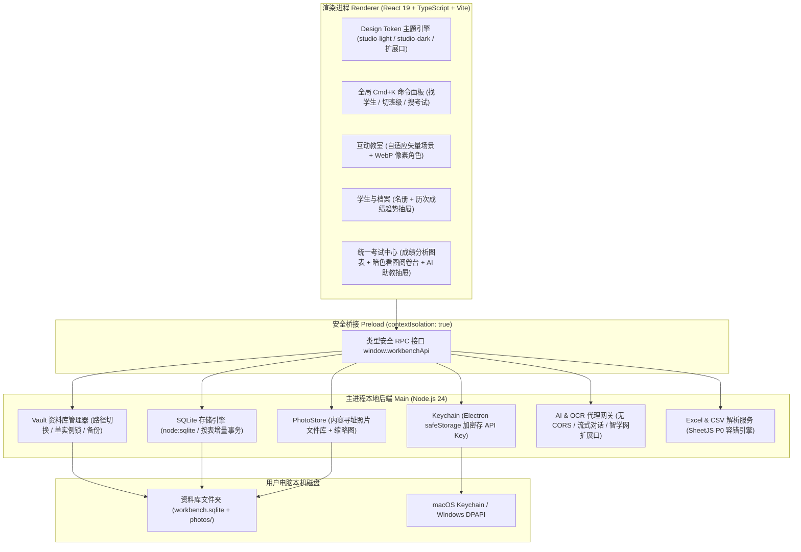
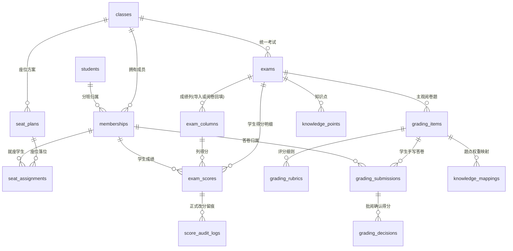

# cyz 的教师工作台 v1.0 — 桌面端架构与界面重构蓝图

> **目标**：从“16 MB 单文件浏览器拼接版”彻底重构为**像 Notion / Obsidian 一样优雅、轻快、数据可靠、全模块打通的独立桌面客户端（Electron）**。完整技术选型对比与决策理由见 [decisions-desktop-tech-stack.md](decisions-desktop-tech-stack.md)。

---

## 1. 已对齐的核心产品与架构决策

| 维度 | 最终决策 | 解决的原先痛点 |
| --- | --- | --- |
| **产品定位** | 全功能保留（互动教室、花名册、成绩分析、手写 AI 阅卷 + **内嵌智学网网阅伴侣**），彻底打通为闭环系统 | 消除“四合一孤岛”，教室、档案、成绩、阅卷与智学网全面联动 |
| **交付形态** | **Electron 45+ 独立桌面客户端**（先出 macOS `.dmg`，同时支持在 Mac 上直接打 Windows 绿色 `.zip` 给同事用，开发配国内 `npmmirror` 镜像） | 根治浏览器 `file://` 换路径丢缓存、跨域（CORS）拦 AI/OCR、大照片卡顿与跨端编译坑 |
| **后端存储** | **Obsidian 式本地资料库文件夹（Vault）**：Electron 内置 Node 24 **`node:sqlite`**（零 C++ 编译）+ `photos/` 照片目录 | 告别每改一步全库复制几十 MB 图片，且彻底免除 `better-sqlite3` 跨平台编译地狱 |
| **修改与删除** | **软删除回收站 + 正式成绩改分留痕**（30 天可恢复，支持手动清空释盘） | 告别旧版“只追加禁止删除”导致错导数据永留库里的反人类限制 |
| **数据兼容** | 彻底轻装上阵，不背旧版 `.cyz.json` / `.cyz-backup.zip` 历史迁移包袱 | 砍掉上千行 v1/v2 兼容与手写无压缩 ZIP 冗余代码 |
| **前端栈与气质** | **React 19 + Tailwind CSS + Radix/shadcn 组件 + Apache ECharts + Lucide + `cmdk`**；首发「现代精致工作室」+「深夜护眼」+ **Design Token 多主题切换引擎** | 用成熟开源库替代丑陋原生 `<select>` / 简陋 CSS 进度条，预留无限换肤能力 |
| **教室视觉** | 保留 29 个动漫像素角色与课桌（转轻量 WebP 外部加载），背景升级为**自适应矢量精致教室** | 根治 `room.png` 拉伸变形，任意行列布局完美适配并随主题变色 |
| **智学网与 AI** | 用 Electron **`WebContentsView`** 洁净独立实现「智学网 + 通用框选」内嵌阅卷（不复制 GPL-3.0 源码）；保留并打磨两段盲识图 AI 阅卷引擎 + 只读**学情对话助教**；API Key 用 **`safeStorage` 钥匙串加密** | 告别刷新丢 Key、CORS 报错、装浏览器插件的麻烦与 GPL-3.0 协议传染风险 |

---

## 2. 总体技术架构（Electron 全栈 TypeScript）

采用标准三层安全隔离架构，所有磁盘读写、SQLite 事务、密钥加解密与 AI/OCR 联网调用全部收敛在 Electron 主进程（本地后端），渲染层只专注流畅交互与视觉呈现。



### 关键底层工程守则
1. **彻底根治性能炸弹**：SQLite 按实体表增量读写（改一个座位仅更新 2 行记录，耗时 `< 1ms`）；照片独立存储于 `photos/<examId>/<hash>.jpg`，数据库只存相对路径与尺寸元信息，永不把几十 MB 图片塞进 JSON 或反复拷贝。
2. **云盘同步安全保护**：Vault 内的 SQLite 采用 `journal_mode = DELETE`（或在退出/空闲时自动 checkpoint）+ 目录锁文件（`.workbench.lock`），防止用户在 iCloud / 坚果云中误双开导致数据库损坏；并在“设置 → 资料库”提供一键快照打包导出。
3. **API Key 零泄露**：所有大模型与 OCR 密钥通过 Electron `safeStorage` 加密存在本机用户配置目录（`app.getPath('userData')`），**绝不写入 Vault 文件夹**——哪怕你把资料库文件夹同步到云盘或发给同事，密钥绝对安全。
4. **本地图片安全访问**：通过主进程自定义协议 `workbench-asset://` 读取当前 Vault 照片和内置 WebP 角色图集，严禁关闭沙箱或放开任意本地文件路径读取。

---

## 3. Obsidian 式本地资料库与统一数据模型

### 3.1 Vault 资料库目录结构
默认路径：`~/Documents/cyz教师工作台`（首次启动可自定义，随时可切换或新建资料库）：

```text
cyz教师工作台/
├── vault.json              # 资料库元信息（名称、创建日期、Schema 版本）
├── workbench.sqlite        # 唯一关系型数据库（全部结构化业务数据）
└── photos/                 # 按考试归类的手写答卷原图与裁剪图
    └── <exam-id>/
        ├── <sha256>.jpg
        └── thumbs/         # 自动生成的轻量缩略图（流畅列表预览）
```

### 3.2 统一关系型数据模型（ER 图）

将原先割裂的「成绩册」与「手写阅卷」彻底收归至同一实体 **`exams`**：



### 3.3 核心闭环规则
- **统一分数精度**：所有分数继续沿用 `units` 整数百分制（如 `85.5 分 = 8550`），杜绝浮点数精度误差；区分 `score`（含真 0 分）、`absent`（缺考，不拉低均分）、`exempt`（免考）、`missing`（未录入）。
- **阅卷自动回填成绩总表**：每场考试中，每道阅卷题（或“主观题合计”）自动关联一个 `source = 'grading'` 的 `exam_columns` 列；老师或 AI 批量台一经确认得分，主进程在同一事务中自动更新 `exam_scores`，成绩分析页实时可见。
- **软删除回收站**：`classes`、`exams`、`grading_submissions` 等核心实体均带 `deleted_at` 字段；删除即移入“回收站”视图，30 天内一键恢复；在回收站点击“彻底清空”时同步删除硬盘上对应的孤立 `photos/` 照片文件，释放磁盘空间。
- **正式改分留痕**：对已确认的成绩单元格或阅卷得分进行修改时，自动向 `score_audit_logs` 写入一条轻量记录（旧值、新值、修改原因、时间），随时可查但不妨碍纠错。

---

## 4. 旧代码“复用 vs 清理”精确清单

| 处理策略 | 涉及模块 | 说明 |
| --- | --- | --- |
| **精选复用并提纯** | `src/modules/grading/ai-engine.ts` | 保留 Otsu 空白/废图检测、VLM 盲识图 × OCR 数值单位交叉标黄、4 维置信度 + 硬红线 + 功率滑块、参考答案拆点（已全绿单测） |
| **精选复用并提纯** | `src/modules/grading/score-policy.ts` | 保留确定性整数分值步长与互斥组计算规则 |
| **精选复用并提纯** | `src/modules/gradebook/workbook.ts`、`recognize.ts`、`analysis.ts` | 保留已攻克 P0 难题的多行表头、公式缓存核对、多班筛选、汇总行排除与统计计算引擎 |
| **精选复用并提纯** | `src/modules/seating/` + `assets/catalog.json` | 保留排座纯逻辑与 29 个角色精确裁切坐标；6 张 PNG 转码为高质 WebP（体积从 ~11 MB 压至 ~1.5 MB） |
| **彻底废除替换** | `persistence/index.ts`、`store.ts`、`backup/zip.ts` | 废弃 Dexie 全库 snapshot 拷贝、手写无压缩 ZIP 与 v1/v2 迁移逻辑，全面替换为 SQLite + PhotoStore |
| **彻底废除替换** | `assistant/tools.ts`、`PhysicsMeanQuery.tsx` | 废弃 370 行闲置 Agent 提案空壳与写死单题按钮，替换为流式只读「学情对话助教」 |
| **彻底废除替换** | `src/ui/*`、`src/ui/styles.css`、`room.png` | 全面重做前端组件、样式体系与自适应矢量教室场景 |

---

## 5. 前端视觉与交互重塑设计

### 5.1 信息架构收敛（4 变 3 + 全局 `Cmd+K`）

左侧细腻半透明导航栏（支持 `Cmd+\` 收起）从原先割裂的 4 个模块收敛为 **3 个高内聚工作空间**：

1. **互动教室（默认主舞台）**
   - **自适应矢量精致教室**：纯净木纹地板、柔和侧窗采光线条、顶部精致黑板（自动显示当前班名与学期）、木质讲台、两两成组的清晰过道——无论 4×6 还是 8×10 班型都完美等比自适应，**彻底告别拉伸变形**。
   - **像素角色融合**：29 个高清 WebP 动漫像素角色坐在课桌前，悬停轻微回头，姓名牌清晰可读；顶部浮层轻工具栏集成**快速找人**、**随机点名（带轻量抽签动画）**、**进入排座**。
   - **智能排座升级**：保留拖拽实时预览与撤销，新增**「参考成绩排座」**（选择本班某场考试，一键支持按成绩 S 形排座、强弱互助搭配或分组落位）。
   - **学生立体档案抽屉**：点击教室任意人物滑出右侧抽屉——上方是像素形象与换装，下方直接展示该生**历次考试成绩折线趋势图、班内名次变化与最近答卷照片快捷入口**。
2. **学生与档案**
   - 清爽高密度名单表（搜索、性别/排座状态胶囊筛选、自定义排序）、2 步极速导入向导、快捷查看任意学生成长曲线。
3. **统一考试中心**
   - 考试列表采用时间轴卡片，一眼看到每场考试的均分、参测人数、是否挂载手写阅卷题。
   - 进入单场考试，通过顶部精致分段器切换 4 个协同视图：
     - **成绩分析与多考对比**：KPI 卡片 + **交互式 SVG 分数段直方图**（点柱筛人）+ **多次考试班级均分/优秀率趋势对比图** + 可排序明细表 + 匿名/实名导出；点击右上角唤出**「学情对话助教」右侧抽屉**（自由提问、隐私开关清晰标明仅发统计摘要或脱敏数据）。
     - **导入 / 修订成绩单**：沿用好用的 4 步向导，支持公式缺缓存核对与多班识别；错导可直接移入回收站。
     - **手写答卷与 AI 批阅台**：重构为专业审稿软件质感——**左侧深色沉浸式看图区**（无级缩放、旋转、拖拽框选裁剪、OCR 数值/单位冲突标黄直显），**右侧亮色极速打分与批量半自动功率面板**（快捷键给分、`Esc` 急停、一键采用 OCR 值）；每确认一份自动回填本场成绩总表。
     - **知识点讲评**：知识点权重分配 + 薄弱点排行柱状图 + 离线讲评报告导出。
4. **全局能力**
   - **`Cmd+K`（Windows `Ctrl+K`）全局命令面板**：任意页面瞬间搜索学生直达档案、切换班级、跳转考试、切换主题。
   - **底部统一工具区**：回收站、资料库管理与一键备份、AI 模型与钥匙串设置、主题风格切换器。

### 5.2 Design Token 主题引擎架构（预留多风格切换）

所有颜色、材质、圆角、字阶、投影、教室矢量配色、图表色板均由语义化 CSS Token 驱动，通过 `ThemeDefinition` 注册表管理，并持久化至本机偏好：

- **首发旗舰主题 `studio-light`（现代暖白工作室，默认）**：Craft / Notion / macOS 原生美学——一体化无边框红绿灯标题栏（macOS `hiddenInset`）、温润纸白主画布（`#FAF9F6`）、极简灰暖侧栏、克制松绿/靛蓝点缀、自定义精致下拉框与轻弹确认浮层（彻底消灭浏览器原生 `<select>` 和 `window.confirm`）。
- **内置验证主题 `studio-dark`（深夜护眼工作室）**：深炭黑画布 + 柔和暖光矢量教室，现场验证主题切换引擎无缝工作。
- **预留标准扩展接口**：主题定义独立拆分为 `src/renderer/themes/*.ts`，后续新增「日系手账风」「极客 Linear 风」「全站像素 RPG 风」仅需新增一份 Token 配置对象即可插拔上线。

---

## 6. 分阶段实施路线图与验收节点

为了让你每一步都能亲眼验收、绝不闭门造车，按 **5 个清晰阶段**推进：

| 阶段 | 核心交付内容 | 你的验收方式 |
| --- | --- | --- |
| **阶段 1：Electron + SQLite 后端地基** | 搭建 Electron + Vite + TypeScript 工程结构；6 张素材转码 WebP；落地 Vault 管理器、SQLite 统一表结构、PhotoStore、软删除回收站、Keychain 加密库与 AI 主进程无跨域代理；跑通后端单元测试 | 双击启动原生桌面窗口，验证自选 Vault 文件夹生成 `workbench.sqlite`，刷新后 API Key 仍在 |
| **阶段 2：主题引擎 + 矢量教室 + 学生档案** | 实现 `studio-light` / `studio-dark` 主题切换、一体化桌面外壳、`Cmd+K` 搜索、自适应矢量教室、29 像素角色无拉伸渲染、拖拽排座、随机点名与学生立体档案抽屉 | 现场切换主题、测试 4×6 与 8×10 班型无畸变、拖动换座、点学生弹档案抽屉 |
| **阶段 3：统一考试中心（成绩分析 + AI 助教）** | 接入 P0 Excel/CSV 导入引擎、交互式分数段图、多次考试趋势对比图、成绩导出、参考成绩排座、流式只读「学情对话助教」抽屉与回收站 | 导入真实成绩表，验证学生档案里自动画出成绩曲线、可用 AI 自由问答学情、错导考试可删可恢复 |
| **阶段 4：专业审稿阅卷台（AI 批阅 + 自动回填）** | 接入提纯后的 `ai-engine.ts`，打造深色看图 + 亮色打分审稿台、参考答案 AI 拆点、VLM×OCR 标黄、半自动功率批量台与知识点讲评；阅卷确认自动回填成绩总表 | 实机用真实 API Key 试测一张手写物理照片，验证无 CORS 报错、打分后自动同步进成绩册 |
| **阶段 5：真机打磨与客户端打包** | 性能压测（百张照片不卡顿）、快捷键与空态抛光、配置 `electron-builder` 输出 macOS `.dmg` 安装包（并预置 Windows `.exe` 构建配置） | 直接把 `.app` 拖进“应用程序”双击运行，完成最终甲方验收 |

---

> [!IMPORTANT]
> **请甲方审阅拍板**：如果对上述蓝图的**架构底座、数据打通方式、前端风格与 5 阶段路线**满意，请确认开始 **阶段 1**；如果有任何细节想调整（例如默认路径、主题细节、阅卷交互习惯或优先顺序），直接告诉我即可修改！
