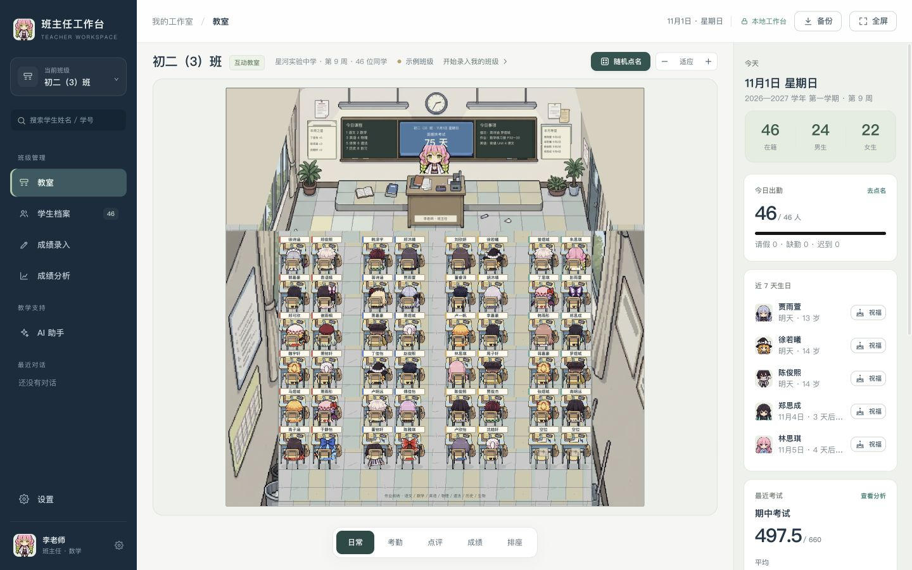

# 班主任工作台 macOS 运行核查

核查日期：2026-10-31。当前本地版本 1.2.0，分支 `dev/modular-studio`，基于上游 `0bcff76f7def9afcf73338ec21df34dff5723899`。本文记录模块化与界面改造后的结果；改造前的记录保存在[原始版本 Mac 核查](原始版本Mac核查.md)。

## 2026-11-01 紧凑布局补充

教室顶部的班级信息和工具改为横排，宽度不足时换行。1024×768 下画布上方占用从 168 像素降为 56 像素；663×807 下约为 67 像素。另检查 1024×600、1440×900 和 390×700，未见顶部与画布重叠或页面横向溢出。左上角显示当前教师角色，主入口示例为甘露寺蜜璃。浏览器没有记录 warning/error；静态检查、16 项测试、格式检查和构建通过。

## 运行结论

已在这台 Mac 上通过 Node 服务启动新版工作台，并在应用内浏览器打开主要页面。本机地址为 `http://127.0.0.1:8765/index.html`。不需要 Windows、虚拟机或 Electron。

开发入口与单文件构建产物都已通过 HTTP 打开。独立文件的 `file:` 入口没有验收：本次浏览器工具只允许 HTTP/HTTPS，阻止了文件协议导航。没有改换浏览器或绕过限制。双击 `启动工作台.command` 的 Finder 流程也未操作；脚本已通过 zsh 语法检查，其底层 Node 服务已实际运行。

## 1.2.0 像素教室验证

本轮在 Mac 应用内浏览器检查开发入口与单文件 HTTP 入口。交互测试使用临时端口的独立示例班级，没有在主入口执行考勤、积分、性别或换座测试。主入口加载时补齐并纠正角色身份，保留原班级资料。

- 29 种角色元数据齐全，按 9 男／20 女分配。旧班级中与学生性别不匹配的角色自动纠正；已匹配的选择保留。
- 女生编辑面板显示 20 个女角色；切换为男生时显示 9 个男角色，头像名称与角色一致；取消后原档案保留。
- 手动更换学生形象后保存、刷新，形象保持；点击两座互换和拖动互换后，形象跟随学生。
- 考勤点击更新状态和人数；点评加分更新积分；随机点名显示学生及新正面头像；成绩模式显示排名和桌面着色。
- 男教师默认炼狱杏寿郎，切换女教师显示甘露寺蜜璃；点击讲台能打开对应教师卡片。
- 实际显示 9 排 × 5 组的 90 座布局；修正适应缩放下限后，教室矩形完整落在画布内。24 种合法布局另有自动检查覆盖。
- 主入口学生表逐行核对 46 人：24 名男生、22 名女生，角色性别不匹配数为 0。单文件 DOM 中七张图集均为内嵌 data URL，浏览器未记录 warning/error。
- 角色选择和教室截图见 [美术说明](像素教室美术与角色说明.md)。

16 项检查由原有 9 项兼容检查与 7 项美术／角色检查组成。新增范围包括图集边界、男女教师默认值、固定身份、备份往返、24 种布局、性别纠错、选择面板的性别过滤与头像一致性。美术替换后不再要求旧 SVG 头像逐字相同，保留公共绘制接口检查。

## 本机环境

| 项目 | 本次环境 |
| --- | --- |
| 操作系统 | macOS 26.6，Build 25G72 |
| CPU | Apple Silicon，arm64 |
| Node.js | 24.22.1 |
| npm | 11.19.1 |
| 页面核查 | 应用内浏览器 |
| 窗口 | 检查了 1440 × 900、1024 × 768；单文件产物也在 1280 × 720 打开 |
| 依赖 | 已安装项目开发依赖并生成锁文件，没有升级系统工具链 |

## 代码与构建检查

| 项目 | 结果与范围 |
| --- | --- |
| `npm run check` | 36 个 JavaScript 模块通过语法、未声明变量、导入和循环依赖检查；JS/CSS 打包无警告 |
| `npm test` | 16 项通过，见下文；使用独立内存数据，不接触实际班级 |
| `npm run build` | 生成 `dist/index.html`，JS/CSS/七张 PNG 内嵌，复制 `dist/LICENSE` |
| `npm run format:check` | 源码、脚本、测试和入口格式检查通过 |
| 启动脚本 | `zsh -n 启动工作台.command` 通过；文件有执行权限 |
| 服务状态 | `/__health` 返回版本 1.2.0；监听 `127.0.0.1:8765` |
| 服务目录范围 | `/.git/config` 返回 404；服务只提供应用资源 |

9 项兼容性检查分别覆盖：旧数据结构和迁移、成绩排名及分母、分数解析、CSV 与粘贴表格解析、46 人示例和 4 次考试统计、存取往返、AI 模板与 Markdown、美术公开绘制接口、原有页面与委托动作的注册项。比较基线来自固定的上游 Git 提交。

最后一项是注册项检查，不是逐个按钮点击验收；存取往返用内存实现，也不等于已验证浏览器配额耗尽。当前没有 TypeScript，不能将这些检查称为类型检查。

## 浏览器中实际检查了什么

| 页面或操作 | 观察结果 |
| --- | --- |
| 开发版启动与刷新 | 进入已有示例班级，导航与教室显示正常 |
| 首次启动 | 在临时端口的独立存储中显示引导页，开启后加载 46 人示例班级 |
| 教室 | SVG 人物、黑板、模式切换、点名与概况入口可见 |
| 随机点名 | 生成被抽中学生的卡片，可关闭 |
| 考勤模式 | 日期、人数、状态说明、全勤和导出入口出现 |
| 学生档案 | 名单、筛选和学生抽屉可打开，档案标签与数据可见 |
| 成绩录入 | 4 次考试与编辑表格显示正常 |
| 成绩分析 | 图表、排名与考试对比显示；示例期中平均分 497.5、满分 660、及格率 89.1% |
| AI 助手 | 首页和模板表单可打开；填入教案课题后，无 API 配置时生成提示词窗口 |
| 设置 | 班级信息、备份与恢复入口、存储统计可见 |
| 小窗口 | 导航压缩；班级概况可展开和收起，关闭后不保留可聚焦的隐藏控件 |
| 单文件产物 | 通过 HTTP 打开并初始化；在隔离的示例数据里新增待办，刷新后仍存在 |
| 页面日志 | 核查时捕获的 error/warn 列表为空 |

交互核查只使用示例班级。临时端口用于隔离首次启动和待办写入，结束后停止该服务；日常入口仍固定为 8765，没有改动用户真实班级。

## 尚未覆盖

### 2026-11-01 界面精简复核

清理范围包括主导航、教室、学生档案、成绩录入、分析、AI 助手、设置和首次启动页。源码中没有渐变；本轮删除毛玻璃和装饰性外框、阴影、重复标签及说明，保留输入名称、选中状态、统计阈值和覆盖数据提醒。

- 最终代码运行 `npm run check`、`npm test`、`npm run build`、`npm run format:check` 和 `git diff --check`，全部通过，测试 16 项通过、0 项失败。
- 1440×900 下查看六个主页面；390×780 下检查 AI 和教室，无页面横向溢出，教室标题未盖住画布。
- 实际操作：打开 AI 教案模板、切换模板分类、搜索学生、打开并取消编辑、切换分析考试；设置中查看教师形象、教室黑板、AI 接口和数据备份。
- 首次启动页在临时端口 18767 的独立存储中检查，切换“直接用我的班级”后表单正常展开；没有提交初始化。临时服务已停止，8765 服务保留。
- 本轮两个页面标签捕获的 warning/error 日志为空。没有修改班级数据，没有调用外部 AI 或执行备份恢复等写入流程。

截图保存在 [screenshots/simplify](screenshots/simplify/)：

| 修改前（390px） | 修改后（390px） |
| --- | --- |
|  |  |

另有 [教室](screenshots/simplify/after-class.jpg)、[成绩分析](screenshots/simplify/after-analysis.jpg)、[教师设置](screenshots/simplify/after-settings-teacher.jpg) 和 [首次启动](screenshots/simplify/after-welcome.jpg) 截图。此轮只验证列出的交互，没有重测全部业务流程、真实 AI 请求或 Windows 真机。

### 未覆盖的业务与环境

没有完整遍历学生新增编辑、考勤写入、点评、拖动排座、成绩粘贴、备份恢复与删除等全部流程。未测试真实班级导入、存储空间耗尽、多标签冲突或异常关机恢复。

没有调用外部 AI，因而模型认证、跨域、计费、流式输出、批量任务和中断恢复尚未实测。未用 Excel、WPS、Word 或打印机验收导出结果，也没有验收 Safari、Intel Mac、旧 macOS、Windows 和手机。

本次结论是“本机能启动，主要页面和已列出的交互可用，关键旧逻辑的比较检查通过”。不能据此承诺所有功能与环境都已验证。

## 使用与停止

当前服务保留运行。若服务已停止，双击 `启动工作台.command`，或在项目目录运行 `npm run dev`。终端运行的服务用 `Control+C` 停止。数据保存在浏览器中，停止服务不会主动清除数据；迁移入口前仍需导出备份。

开发操作和模块说明见[开发手册](开发手册.md)。

## 2026-11-01 动效保留复核

本轮最终保留评语记录、AI 回复、批量结果、提示词预览和教师选择的现有表现；弹窗、抽屉、人物入场、角色跳动和随机点名轮播均保留。仅调整普通设置分组间距、概况统计装饰竖线和关于页内层底色。

- 最终代码：36 模块静态检查、16 项测试、单文件构建、格式检查通过。
- 浏览器点名检查：点击后先高亮候选人且无结果卡，轮播结束后出现结果；结果卡使用 `pop`，角色使用 `pixel-hop`。档案抽屉使用 `slide`，遮罩使用 `fade`。
- 没有调用外部 AI，没有写入班级记录。未重测全部业务流程与 Windows 真机。
- 最终截图：[点名结果](screenshots/flat/final-pick.jpg)。

## 2026-11-01 排座专用视图核查

- 37 个模块静态检查、20 项测试、格式检查和单文件构建通过。新增测试覆盖奇数列迁移保存、缩小与扩大、非法输入不改数据、同桌分配和专用场景边界。
- 在临时端口 18768 的独立示例中，6×8 改为 7×7 后显示 49 座、46 人；撤销后逐个学生座位与原布局一致。2×3 显示 6 座、40 人未排座，扩大为 7×7 后 46 人全部入座。刷新后仍为 7×7。
- 点击两个座位交换成功；切回日常模式恢复教师与完整教室，座位数保持 49。输入 0 行被拒绝，原布局不变。未改日常入口 8765 的班级数据。
- 查看桌面、1024×600 和 390×780 视图；窄屏无页面横向溢出，座位区域与工具栏不重叠。浏览器 warning/error 日志为空。
- [排座桌面截图](screenshots/seating/seating-desktop.jpg)、[小屏截图](screenshots/seating/seating-1024.jpg)、[窄屏截图](screenshots/seating/seating-mobile.jpg)。
- 本轮未实测拖拽手势、打印机输出及 Windows 真机；同桌分配已做代码级测试，未逐一点击验收各自动排座策略。
