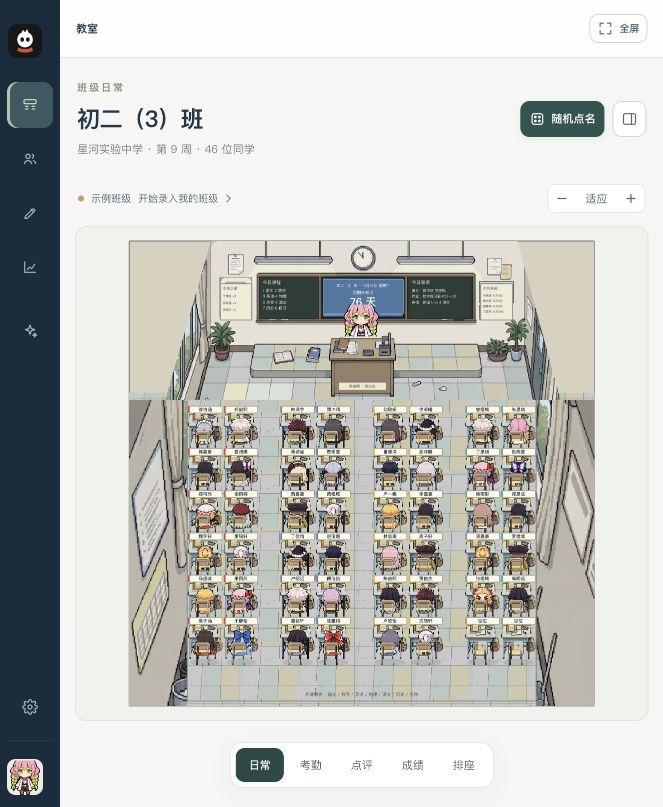
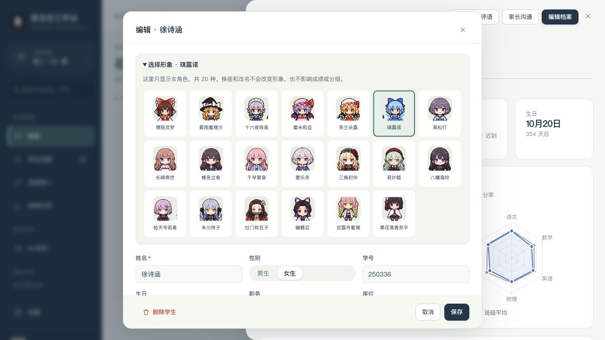

# 像素教室美术与角色说明

版本 1.2.0，2026-10-31。教室背景、课桌、学生和教师已换成你提供的素材。原来的考勤、积分、成绩、排座、点名和档案入口继续使用同一套业务代码。

## 怎么使用

打开 [本地工作台](http://127.0.0.1:8765/index.html)。旧班级第一次加载时，每名学生会获得一个固定角色；新增和导入学生也会自动分配。共 29 种角色：男角色 9 种，女角色 20 种。按学生档案里的性别分配，在同性别角色池中优先使用当前人数较少的形象，允许重复。已有匹配正确的选择保留，先前配错的形象会自动纠正；改名、换座或刷新不会改变角色。修改学生性别时，会相应调整可选角色和不匹配的当前形象。

- 学生：打开学生档案 → 编辑档案 → 展开“选择形象” → 选择同性别角色 → 保存。取消编辑不会保存这次选择。
- 教师：设置 → 教师形象。男老师默认是**炼狱杏寿郎**，女老师默认是**甘露寺蜜璃**；下方也能手动选其他角色。再次点击男／女老师会恢复对应默认角色。
- 座位：教室 → 排座，支持 1–12 行、1–16 列及奇数列；设置页也保留常用布局快捷选项。“适应”显示完整教室；看细节时使用放大和拖动。

课堂默认显示角色背面，回头时切换正面；头像、学生卡片和点名卡使用正面。椅背覆盖角色下半身，形成坐在桌前的效果。当前没有新增坐姿原画。原来举手动作的触发时机保留，视觉改成轻跳；打瞌睡用倾斜和 z 字表现。

完整分组名单见 [角色分类表](角色分类表.md)。

## 模块怎么分工

| 文件 | 职责 |
| --- | --- |
| `src/art/assets.js` | PNG 地址与真实图集尺寸 |
| `src/art/character-data.js` | 29 个固定角色 ID、名称、性别、正反面裁切矩形 |
| `src/core/characters.js` | 自动分配、查找、旧数据补齐、教师默认角色 |
| `src/art/sprites.js` | 图集注册、透明边缘处理、SVG 裁切与头像 |
| `src/art/scene.js` | 教室布局、背景、黑板、桌椅、角色及状态覆盖层 |
| `src/ui/character-picker.js` | 学生和教师共用的角色选择面板 |
| `src/styles/pixel.css` | 人物朝向、轻跳、姓名牌和选择面板样式 |
| `scripts/asset-bundle.mjs` | 构建时把 PNG 内嵌到单文件 HTML |
| `tests/pixel-art.test.mjs` | 素材、角色身份、备份与全部座位布局检查 |

SVG 负责定位和交互，PNG 负责人物与家具。图集只在文档顶部注册一次，每个角色用 `<use>` 引用，再用嵌套 SVG 的 `viewBox` 裁切。不能把完整 base64 图片重复写进每个头像，否则班级人数增加时会显著扩大页面。

教室按前墙、地板、两侧墙体组合。前墙等比缩放，地板取原图的一块平铺，侧墙按可用高度裁切延展。黑板上的课程、事项、倒计时、时钟、本周之星和生日仍由数据绘制，不是写死在图片里。不同排数下，墙面接缝和透视不会完全一致；这是当前复用整张参考图的处理方式。

每个座位保留 `data-seat`、`data-sid`，角色身份另放 `data-character`。`.hit` 是实际点击和悬浮定位区域；不要用整个图集引用组的包围盒定位卡片，SVG 图集可能让包围盒远大于可见人物。`.turn`、`.hand`、`.sleep`、`.picked`、`.ghost`、`.dim` 等原有状态类继续生效。

## 数据和备份

学生新增 `characterId` 字段；教师的手动选择保存在 `settings.teacher.characterId`。原存储键 `bzr-workbench-v1` 和数据版本 `v: 1` 不变，PNG 不写进浏览器存储。

加载旧备份时补齐缺少的学生角色并保存，并纠正已知角色与学生性别不匹配的情况；匹配正确的角色 ID 保留。遇到未来版本才认识的 ID，本版用同性别的确定性替代形象显示，但保留该 ID，避免一次导入就抹掉未来版本的选择。备份仍是原来的 JSON 导出和恢复流程，角色字段随同保存。

## 素材来源与处理记录

原始图由你在本次对话中提供。`assets/pixel/originals/` 留有六张人物／桌椅原图；`assets/pixel/room.png` 是未经改图的教室参考图。原项目的 `LICENSE` 和源码署名保留，侧栏底部的开发者字样已按要求去掉。这里记录素材来源，不把第三方角色或用户提供的图片声明为本项目原创。

本次使用 **Codex 内置 imagegen** 分别处理五张角色图集和一张桌椅图，要求透明背景；没有使用 API CLI，也没有使用额外 API 密钥。生成图先保存在 Codex 的生成目录，再复制到项目。工具可能改变局部像素或位置，因此不能把结果当作逐像素无损抠图。

每次编辑的提示词约束为：移除纯色背景和姓名牌／文字，保留所有人物的正反面、服装、颜色、相对排列和数量；不加入新角色，不重绘造型；主体不透明，周围透明，尽量保留原画布尺寸。桌椅图要求保留桌子、椅子、书本、文具与书包，只移除白色背景。生成后读取 alpha 通道确定裁切范围，没有再改写 PNG 像素；运行时的 SVG alpha 阈值滤镜会滤掉较淡的背景残留。

下表保留素材处理工具的输出文件名，项目运行不依赖生成目录。

| 项目文件 | 数量／用途 | 内置工具输出 |
| --- | --- | --- |
| `assets/pixel/touhou.png` | 东方 6 人，正反面 | `exec-93b30ddb-2e56-47f1-95e3-c9418846d6b3.png` |
| `assets/pixel/mygo.png` | MyGO 5 人，正反面 | `exec-a2f27721-9416-4a4e-93cf-f95aff1898b7.png` |
| `assets/pixel/ave.png` | Ave Mujica 5 人，正反面 | `exec-f8aa5885-a1f3-4ea9-b2ac-162962be27f9.png` |
| `assets/pixel/trio.png` | 炭治郎、祢豆子、善逸，正反面 | `exec-207de8b9-b068-4531-815f-87377c72bd00.png` |
| `assets/pixel/hashira.png` | 鬼灭角色 10 人，正反面 | `exec-9c06a76d-cf22-4810-b6ab-3f5a4badd0b0.png` |
| `assets/pixel/desk.png` | 桌椅、书包与文具 | `exec-2a2f6b24-7c47-4fe4-ad46-099f0fe5e3a5.png` |

## 以后加角色或换素材

1. 将新的透明 PNG 放入 `assets/pixel/`，保留原始参考图。不要覆盖已有角色 ID 所指向的不同人物。
2. 在 `assets.js` 登记地址和图片真实尺寸。
3. 在 `character-data.js` 添加固定 `id`、`name`、`gender`（`M` 或 `F`）、`sheet`、`front`、`back`。矩形格式是 `[左, 上, 宽, 高]`，单位为原图像素。人物必须完整落在矩形内，并留少量边缘。
4. 查看教室的正背面切换、头像和选择面板；换桌椅时同时修改 `scene.js` 里的整桌和椅背裁切矩形，避免椅背遮住头部。
5. 执行 `npm run check`、`npm test`、`npm run build`。角色数量增加后，更新测试中明确写出的角色总数；保留旧 ID 的兼容性检查。

开发版通过本地路径读取图片；构建版将七张 PNG 内嵌成 data URL，当前 `dist/index.html` 约 16 MB。图片随文件携带，体积比原来的纯 SVG 版本大。单文件已经通过本机 HTTP 加载验证，Finder 双击和其他浏览器的文件协议入口尚未验收。

本次共有 16 项检查通过，其中包含 24 种布局、角色固定身份与备份往返。Mac 浏览器中另行验证了换形象后刷新、点击换座、拖动换座、考勤、点评、随机点名、教师切换和 90 座布局。具体范围见 [macOS 运行核查](macOS运行核查.md)。
