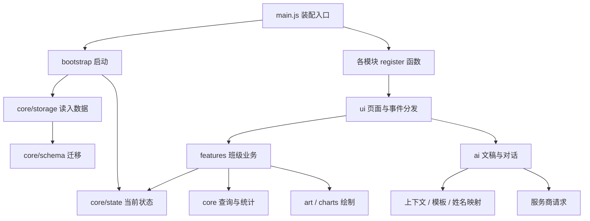

# cyz的教师工作台开发手册

当前版本：1.2.0，更新日期：2026-11-01。项目仓库：[cyz的教师工作台](https://github.com/chengyingzh433-stack/cyz-teacher-workbench)。

项目已经能在这台 Apple Silicon Mac 上启动。原来集中在 `index.html` 里的代码，现已拆成 37 个 JavaScript 模块；界面改为深蓝导航、浅色工作区和绿色操作按钮。教室使用新像素素材，班级资料、成绩规则、AI 模板和原有功能入口保留。20 项检查通过，但这不代表每一种业务操作都已验收，具体范围见 [macOS 运行核查](macOS运行核查.md)。

像素资产分层、29 种角色、教师默认形象、备份兼容和扩展步骤见 [像素教室美术与角色说明](像素教室美术与角色说明.md)。新增角色模块是 `core/characters.js`，共用选择面板是 `ui/character-picker.js`。

界面修改先读 [DESIGN.md](../DESIGN.md)。当前采用白底、文字层级和留白分组，已移除重复说明、小药丸标签和装饰外框；必要的表单边界、选中状态和真实业务信息保留。不要再把删除的问候区、模板描述和多层卡片加回来。

## 1. 先把项目跑起来

项目目录：

```text
/path/to/cyz-teacher-workbench
```

日常使用可以双击根目录的 `启动工作台.command`。它会启动本机服务并打开浏览器；服务运行期间保持终端窗口开启。已有服务时，它会直接打开工作台。停止服务按 `Control+C`。

开发时建议从终端启动，这样能看到端口占用等错误：

```bash
cd "/path/to/cyz-teacher-workbench"
npm run dev
```

打开 [本地工作台](http://127.0.0.1:8765/index.html)。修改源码后刷新页面即可，目前没有热更新。这个启动服务只用 Node.js 自带模块，首次启动不必先安装 npm 依赖。Node.js 要求 20 或以上，本机已使用 24.22.1 验证。

**固定使用同一个浏览器和地址。** 数据存在浏览器的 `localStorage` 中；`localhost`、`127.0.0.1`、不同端口和直接打开文件，可能对应不同的数据。换入口、清理浏览器或迁移电脑之前，先在“设置 → 数据与备份”导出备份，再到新入口恢复。项目目录里没有一份自动同步的班级数据库。

首次开发或重新安装依赖时：

```bash
npm ci
npm run check
npm test
npm run build
```

| 命令 | 用途 |
| --- | --- |
| `npm run dev` / `npm start` | 监听 `127.0.0.1:8765`，提供本地网页 |
| `npm run check` | 检查 JS 语法、未声明变量、导入关系、循环依赖和打包警告 |
| `npm test` | 将关键业务结果与固定的上游版本比较 |
| `npm run build` | 输出内嵌 JS、CSS 和 PNG 图集 的 `dist/index.html`，同时复制 `LICENSE` |
| `npm run format` | 按项目规则格式化源码、脚本和测试 |
| `npm run format:check` | 只检查格式，不改文件 |

根目录的 `index.html` 是模块化开发入口，需要通过 HTTP 打开。构建后的 `dist/index.html` 才是用于独立打开的单文件版本；本次已通过 HTTP 验证构建产物，尚未验收它的 Finder 双击流程。不要直接修改 `dist/`，下一次构建会覆盖它。

原有 `ai-proxy.js` 保持不变，需要时另开一个终端运行 `node ai-proxy.js`。它只转发 AI 请求，不负责运行网页，也不保存班级数据。AI 接口为空时，仍可以生成提示词并自行复制到其他 AI 工具。

## 2. 它有哪些功能

| 模块 | 主要功能 | 代码入口 |
| --- | --- | --- |
| 互动教室 | 学生人物与座位、日常/考勤/点评/成绩/排座模式、随机点名、缩放、班级概况、生日和待办 | `src/features/classroom.js` |
| 学生档案 | 新增编辑、搜索筛选、Excel 粘贴与 CSV 导入导出、家庭信息、成长记录、成绩和评语 | `src/features/students.js` |
| 成绩录入 | 考试与科目设置、单格编辑、整块粘贴、缺考和未录区分、成绩导出 | `src/features/scores.js` |
| 成绩分析 | 均分、及格率、优秀率、排名、分数段、趋势和考试对比 | `src/features/analysis.js`、`src/core/statistics.js` |
| AI 助手 | 教案、班会、通知、沟通材料、分析报告、批量评语；上下文选择、姓名替换、对话、停止、重试和导出 | `src/ai/` |
| 设置与备份 | 班级、教师形象、教室、黑板、学科、点评规则、AI 配置、JSON 备份恢复 | `src/features/settings.js` |
| 首次启动 | 教师形象、称呼、学科，以及示例班级或空班级 | `src/features/onboarding.js` |

目前仍是一个当前班级、一份本地数据。没有账号、云同步、学校后台、多人协作、题库或自动批改。家校沟通功能用于起草文稿，不会发送家长消息。

## 3. 技术路线与目录

继续使用原生 JavaScript、CSS 和 SVG。浏览器负责界面、计算和存储，开发工具只负责检查、格式化和构建。这样可以先拆清现有代码，避免同时更换框架和业务实现带来的排查困难。以后是否迁移到 React 或 Vue，可以按实际开发需求决定。

```text
workstation-teacher/
├── index.html                 页面容器和开发入口
├── src/
│   ├── main.js                装配依赖、注册模块、启动应用
│   ├── bootstrap.js           读入数据、首次引导、恢复路由
│   ├── core/
│   │   ├── state.js           当前状态 S 与 replaceState
│   │   ├── schema.js          defaultState、旧数据迁移
│   │   ├── storage.js         本地存储、延迟保存、失败通知
│   │   ├── constants.js       存储键、应用版本和业务常量
│   │   ├── queries.js         学生/考试/日期等查询
│   │   ├── statistics.js      成绩统计、排名与趋势
│   │   ├── table.js           粘贴表格和 CSV 解析/导出
│   │   ├── demo.js            示例班级
│   │   └── utils.js           通用工具
│   ├── ui/
│   │   ├── workspace.js       导航、路由、弹窗、抽屉等公共界面
│   │   ├── events.js          事件委托、搜索、全屏
│   │   ├── files.js           下载和复制
│   │   └── icons.js           图标
│   ├── features/              六个业务模块，见上表
│   ├── ai/
│   │   ├── providers.js       服务商配置、请求与流式响应
│   │   ├── context.js         班级、学生、考试上下文
│   │   ├── mask.js            学生姓名与编号映射
│   │   ├── templates.js       模板定义、模板提示词
│   │   ├── session.js         对话界面状态、忙碌状态
│   │   ├── workspace.js       对话界面、模板表单和交互
│   │   ├── batch.js           批量评语流程
│   │   └── markdown.js        Markdown 显示与 Word 导出
│   ├── art/                   场景、图集注册、正反面裁切数据与头像绘制
│   ├── charts/charts.js       图表绘制
│   └── styles/
│       ├── app.css            样式入口
│       ├── base.css           保留的原版样式
│       ├── studio.css         新界面的颜色、排版与响应式布局
│       └── pixel.css          像素人物状态与角色选择面板
├── scripts/                   启动、检查、构建脚本
├── assets/pixel/              新美术素材和原始参考图
├── tests/                     业务兼容性与像素资产检查
├── docs/                      中文说明与核查记录
├── dist/                      构建产物，不纳入 Git
├── 启动工作台.command          Mac 启动入口
├── ai-proxy.js                原有可选 AI 代理
└── LICENSE                    原作者的非商业许可全文
```

`src/package.json` 将前端声明为 ES Module。根目录没有改成 ESM，因此原有 CommonJS 代理仍能用 `node ai-proxy.js` 启动。

### 模块怎样协作



这是运行流程示意，不是逐项导入图。实际静态导入关系由 `npm run check` 检查，当前没有循环依赖。

每个业务模块导出 `register...()`，由 `main.js` 按顺序调用。导入模块本身不会自动注册整套页面和事件；存储模块仍会在初始化时检查 `localStorage` 是否可用。

跨模块的少量交互由入口传入。例如教室打开学生档案，需要 `openStudent` 和 `openStudentForm`；批量评语需要对话呈现和提示词弹窗。这些依赖在 `main.js` 中装配，避免教室与档案、批量流程与对话页面互相导入。存储失败也通过回调通知界面，存储模块不再直接依赖弹窗实现。

目前业务仍使用共享可变状态 `S`。整份数据替换必须调用 `replaceState(next)`；不能给导入的 `S` 重新赋值。字段修改继续沿用原有方式，之后调用 `save()`，再刷新相应视图。若将来增加多班级或协作，建议先把业务写入收口到独立接口，再扩展存储方式。

## 4. 一次操作怎样执行

以成绩录入为例：

1. 用户编辑单元格或粘贴 Excel 区域，`ui/events.js` 或页面自己的监听器接收事件。
2. `features/scores.js` 解析输入，区分数字、缺考和空白，修改当前考试的 `scores`。
3. `save()` 将整份 `S` 写入原来的存储键。通常延迟 250 毫秒合并写入，立即保存使用 `save(true)`。
4. `core/statistics.js` 根据学生名单、考试科目和成绩重新计算，成绩页或分析页更新显示。

以 AI 模板为例：模板表单读取需求，`templates.js` 组织任务说明，`context.js` 选取资料，`mask.js` 按设置替换学生姓名。有接口配置时交给 `providers.js` 发请求；没有配置时打开提示词窗口。返回内容由 `markdown.js` 处理，并由对话页或批量页显示。

## 5. 这次保留了哪些兼容约定

| 项目 | 当前约定 |
| --- | --- |
| 存储键 | 仍为 `bzr-workbench-v1` |
| 数据版本 | 仍为 `S.v = 1`，应用版本 1.2.0 不等于数据版本升级 |
| 顶层数据 | `settings`、`students`、`exams`、`attendance`、`points`、`records`、`todos`、`chats` 等保持原结构 |
| 备份 | 沿用原 JSON 结构与迁移函数，新增学生和教师的可选 `characterId`；没有新建数据库 |
| 成绩 | `0` 是分数，`null` 是缺考，没有科目字段是未录入；原有排名及分母规则保留 |
| 页面和动作 | 原来的页面注册、`data-act`、`data-inp`、`data-chg` 和键盘动作仍有对应实现 |
| SVG 与 AI | 替换美术资产，保留绘制接口、模板 ID、提示词规则和请求流程 |

原代码中有些边界需要以后单独处理：部分科目未录完的学生仍可能进入总分排名；备份包含 AI 配置；姓名替换不能保证自由文本里没有其他个人信息。本次没有借重构改变这些规则，避免旧数据和旧结果在用户不知情的情况下发生变化。详细实现见 [源码功能与数据结构](源码功能与数据结构.md)。

“备份兼容”指数据结构和迁移逻辑相容，不表示文件入口的数据会自动出现在 HTTP 入口；这仍需要手动导出、恢复。

## 6. 界面改了什么

侧边栏将班级管理和 AI 助手分组，顶部保留当前位置、备份与全屏。教室页把班级名称、点名、缩放和模式切换放在固定位置，SVG 布局与新 PNG 图集组合成互动教室。概况侧栏在宽屏显示，在小窗口改为可展开、可收起的面板。

学生表格、成绩表、分析卡片、设置表单、弹窗和抽屉统一了字号、间距、边框与焦点样式。AI 首页保留直接输入和模板两种入口，文案说明可以做什么、接下来怎么操作。新增界面文案按 humanizer-zh 技能复核，删去了“每一天，都看见成长”等没有说明操作的宣传句。AI 业务提示词没有因文案润色而改写。

工作台样式集中在 `studio.css`，角色和美术样式由最后加载的 `pixel.css` 补充。保留 `base.css` 是为了减少对旧交互状态和细节样式的遗漏；后续可以按组件逐步合并重复规则，当前两层样式的顺序不能随意交换。主要断点为 1440、1320、1080、760 和 440 像素；本次检查了桌面和较窄窗口，没有做完整手机端验收。


## 7. 以后改功能，从哪里动手

| 想做的事 | 需要查看的位置与注意事项 |
| --- | --- |
| 调整颜色、按钮、表格密度 | 先改 `styles/studio.css`；行为不变时不必动业务模块 |
| 增加学生字段 | `schema.js`、`students.js`；同时检查导入导出、档案显示与 AI 上下文是否需要该字段 |
| 改成绩算法 | `statistics.js`；先写清缺考、未录、并列名次、分母规则，再改兼容性用例，不能只为了测试通过而替换预期 |
| 增加 AI 模板 | `templates.js` 和 `ai/workspace.js` 的表单读取；先检查生成提示词，再验证联网生成 |
| 接入 AI 服务 | `providers.js`；独立验证认证、协议、流式响应、停止和错误分支 |
| 改教室外观 | `art/scene.js`；座位和场景交互在 `features/classroom.js`，不要在绘图函数里保存数据 |
| 增加新页面 | 新建 feature 模块，导出注册函数，在 `main.js` 注册，并在公共导航加入入口 |
| 多班级、多学期、SQLite | 先设计身份和归属关系、迁移与备份，再改 `schema/state/storage`；不能只增加一个页面选择框 |

新增按钮应复用事件委托。例如页面 HTML 使用 `data-act="my-action"`，注册函数中定义 `UI.act['my-action']`。不要为了跨模块调用，把函数挂回 `window`，也不要在另一个文件里依赖隐含的全局变量。

## 8. 修改后的核查与交付

提交前运行 `npm run format:check`、`npm run check`、`npm test` 和 `npm run build`。涉及界面的修改，还要用示例数据打开对应页面，验证操作后的显示和保存；构建通过不能替代浏览器检查。

兼容性测试从 Git 历史读取固定上游提交，所以开发副本需要保留 `.git`。只下载源码压缩包后直接运行测试会缺少基线；不要把这种错误当成业务回归。测试在独立内存环境运行，不读取实际班级，也不请求外部 AI。

测试用于锁定旧行为。如果下一步确实要修正旧算法，应明确记录前后差别，补充新的预期与迁移说明，然后有意更新相应检查。

本次已验证 Mac 本机启动、主要页面、示例数据和部分交互；真实 AI、完整导入恢复、办公软件打开导出文件、Safari 和其他系统仍未验收。完整记录见 [macOS 运行核查](macOS运行核查.md)。

本项目继续使用原作者的[非商业许可](../LICENSE)，保留 @赛博老爸 署名。本地衍生版的修改范围见 [CHANGELOG](../CHANGELOG.md)，不代表原作者参与或认可这些修改。原始方案和功能研究保存在[原始版本研究](原始版本研究.md)中。

## 排座模式与自定义行列（2026-11-01）

进入“教室 → 排座”，画布只显示学生桌椅，视野自动适配；老师、讲台、黑板、右侧概况暂时收起。切回日常、考勤等模式时恢复完整教室，已有交互动效保留。

底部输入行、列后点“应用行列”，支持 1–12 行、1–16 列，也支持 7 列等奇数列。现有合法座位尽量不动，其余学生安排到空位；座位不足时保留学生资料并显示未排座人数。扩大布局后自动安排未排座学生。“撤销”同时恢复上一步的行列、座位和分组。刷新后布局仍保留，撤销记录仅在当前会话有效。

维护入口：`src/core/seating.js` 集中管理行列、座位键、布局调整和奇数列同桌分配；`src/art/scene.js` 的 `studentsOnly` 参数控制专用画布。`settings.cols` 是实际列数，未设置时继续读取旧备份的 `pairs × 2`；新布局保留 `pairs = ceil(cols / 2)` 用于同桌分组。遍历座位请调用 `columnCount` / `seatKeys`，不要直接把组数乘二。当前共有 37 个源码模块、20 项测试。
