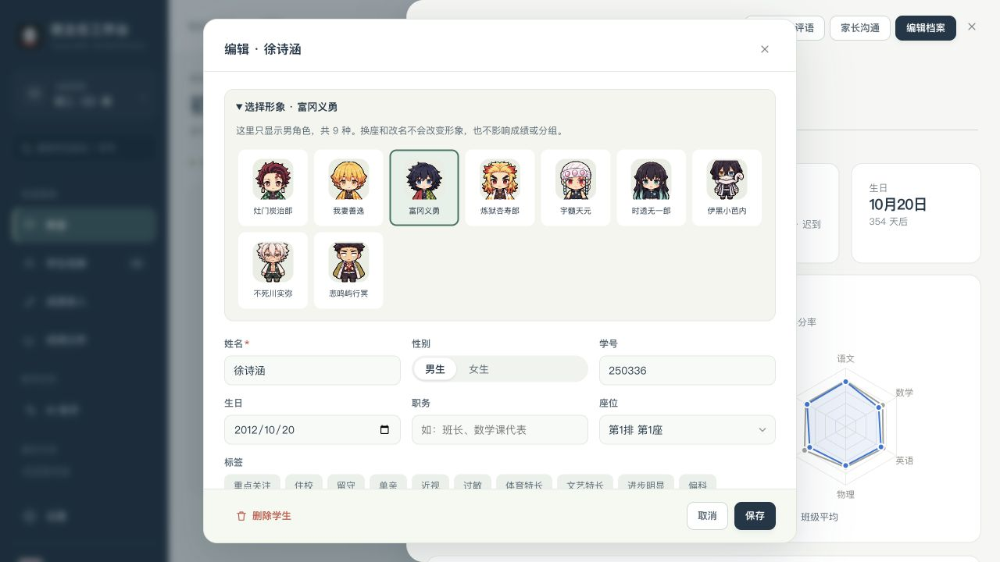
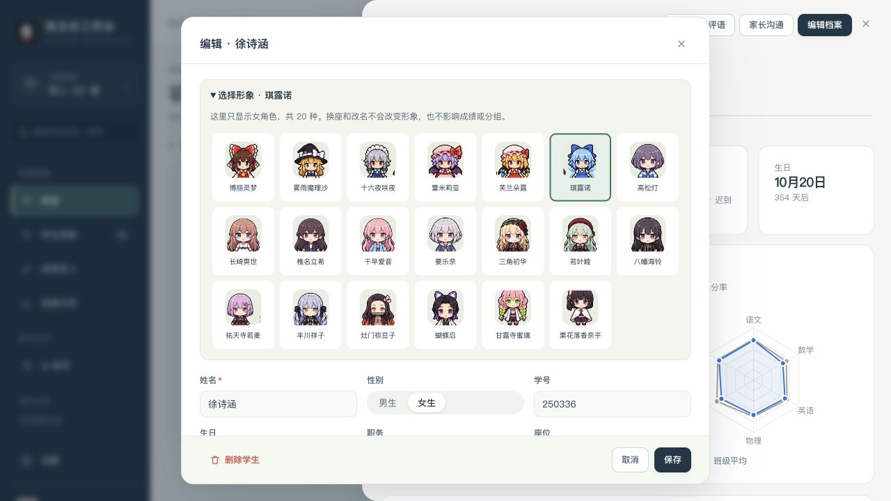

# 角色分类表

2026-10-31，按用户提供的 29 个角色整理。男角色 9 个，女角色 20 个。代码分类以 `src/art/character-data.js` 的 `gender` 字段为准；不根据发型、衣服或学生姓名推测性别。

| 分组 | 男角色 | 女角色 |
| --- | --- | --- |
| 东方（6） | 无 | 博丽灵梦、雾雨魔理沙、十六夜咲夜、蕾米莉亚、芙兰朵露、琪露诺 |
| MyGO（5） | 无 | 高松灯、长崎爽世、椎名立希、千早爱音、要乐奈 |
| Ave Mujica（5） | 无 | 三角初华、若叶睦、八幡海铃、祐天寺若麦、丰川祥子 |
| 鬼灭三人图（3） | 灶门炭治郎、我妻善逸 | 灶门祢豆子 |
| 鬼灭十人图（10） | 富冈义勇、炼狱杏寿郎、宇髓天元、时透无一郎、伊黑小芭内、不死川实弥、悲鸣屿行冥 | 蝴蝶忍、甘露寺蜜璃、栗花落香奈乎 |
| 总计 | 9 | 20 |

男生只分配、选择男角色，女生只分配、选择女角色。男性角色少，可以重复；角色属于学生，不属于座位。当前班级中以前分配错的角色会在加载时自动纠正，已有匹配正确的选择不变。姓名、性别、座位、成绩和积分都不会因为纠正角色而修改。

教师仍使用指定默认值：男老师为炼狱杏寿郎，女老师为甘露寺蜜璃。教师的自选角色入口保留。

核对资料包括 [鬼灭官方人物介绍](https://kimetsu.com/anime/character/mugenresshahen_tv/)、[BanG Dream! 官方网站](https://anime.bang-dream.com/mygo-avemujica/)和[东方红魔乡官方角色页](https://touhou-project.news/shanghai-alice-reprise/cn/)。分类针对图中的作品角色，不根据声优的性别分类。

